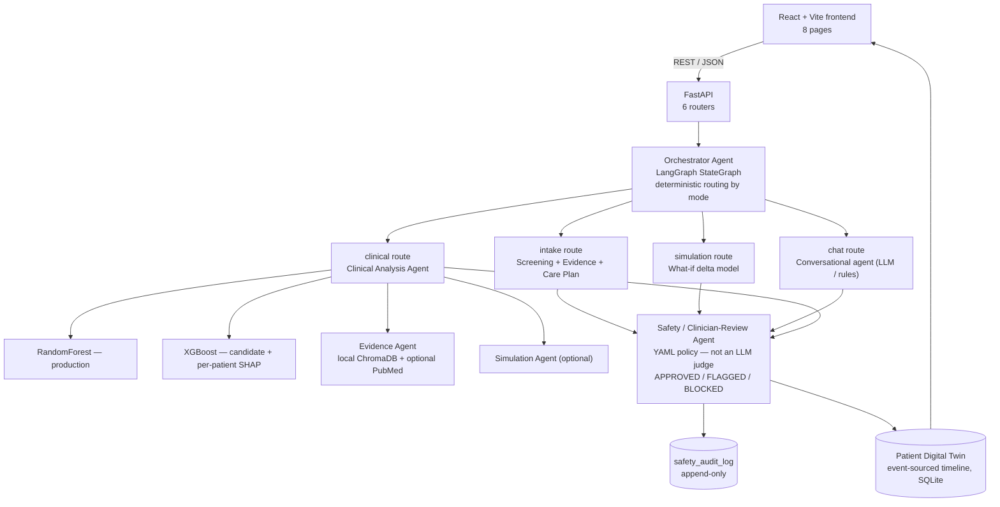

# MedGenesis

### AI-Assisted Clinical Decision Support Research Prototype

> **Research prototype. Not medical advice, not a diagnostic device, and not
> treatment-authoritative.** Every clinically-sensitive output is reviewed by
> a deterministic Safety Agent before it reaches a user. All patient data in
> this repository is synthetic or public and de-identified.

MedGenesis is a multi-agent research prototype exploring what AI-assisted
clinical decision support looks like when it is built around a longitudinal
**Patient Digital Twin** instead of a single-shot prediction. An orchestrator
routes work across specialist agents — a production risk model, a candidate
model kept alongside it for comparison, a medical-evidence retriever, a
what-if simulator, and a Clinical Analysis Agent that composes all of it into
one cited, structured response — and every clinically-sensitive output is
reviewed by a Safety Agent before it is shown.

The system does not diagnose, does not prescribe, and does not claim
autonomous clinical decision-making. It is a decision-*support* research
prototype: every number is sourced, every claim is traceable to a specific
model, evidence passage, or recorded patient fact, and every place it doesn't
know something, it says so instead of guessing.

## Technology stack

| Layer | Technology | Why |
|---|---|---|
| Frontend | React 19 + TypeScript + Vite | Typed components, fast dev loop, no build-tool overhead |
| Frontend state | React Context (no Redux/Zustand) | The state shape is small enough that a dedicated library would be overhead |
| Frontend motion | `motion` (Framer Motion's successor package) | Restrained entrance/expand animations, respects `prefers-reduced-motion` |
| Frontend icons | `lucide-react` | Consistent line-icon set used throughout the nav and section headers |
| Styling | Plain CSS with custom properties | A small, hand-rolled design-token system (spacing scale, light/dark themes) — no CSS framework needed at this scale |
| Backend | FastAPI (Python) | Async-capable, typed request/response schemas via Pydantic, free interactive API docs |
| Orchestration | LangGraph `StateGraph` | Deterministic agent routing — routing is data, not an LLM decision, so the safety gate can't be routed around |
| Production model | scikit-learn RandomForest | Screening-risk baseline, selected by cross-validated ROC-AUC over logistic regression |
| Candidate model | XGBoost | Trained on the identical data/features/split for a fair, transparent comparison |
| Explainability | SHAP (`TreeExplainer`) | Exact (not approximate) per-patient feature attribution for tree ensembles |
| Evidence retrieval | ChromaDB + `sentence-transformers` | Embedded vector store, local-only; falls back to a deterministic keyword ranker if unavailable |
| Literature retrieval | NCBI E-utilities (PubMed) | The standard free public API for medical literature, opt-in per request |
| Database | SQLite | Zero-install, zero-config — the whole project runs with `pip install` and nothing else |
| LLM (optional) | Mistral API → Ollama → rule-based fallback | Three-tier fallback; every non-chat capability works fully offline with no LLM at all |

## Key capabilities

- **Patient Digital Twin** — an event-sourced, append-only patient timeline.
  Nothing is ever overwritten; "current state" is always a computed fold over
  the log, so every displayed value is traceable to the exact event it came
  from.
- **Production + candidate risk models** — a RandomForest screening-risk
  baseline in production, with an XGBoost candidate kept alongside it for
  transparent, honest comparison (never silently promoted).
- **Per-patient SHAP explanations** — real, exact feature-attribution values
  for the candidate model's score on the specific patient being viewed, never
  presented as a cause of the patient's risk.
- **Evidence-grounded retrieval** — a local curated medical-evidence corpus
  (ChromaDB) plus optional live PubMed search, every citation traceable to a
  specific `[E#]` reference.
- **Clinical Analysis Agent** — composes the Digital Twin, both models,
  retrieved evidence, and an optional what-if simulation into one structured,
  cited response, with tested defenses against fabricated citations and
  model-score mismatches.
- **What-if simulation** — forks a copy of the Digital Twin, applies a
  transparent delta heuristic, and projects a risk trajectory without ever
  touching the real patient timeline.
- **Deterministic Safety Agent** — a YAML policy engine (not an LLM judge)
  that reviews every clinically-sensitive output before it is returned,
  structurally on every route.

## Architecture



Every route above passes through the Safety Agent before returning — this is
a structural property of the LangGraph edges, not a convention (see
[docs/SAFETY.md](docs/SAFETY.md)).

### Agents

| Agent | Implementation | Notes |
|---|---|---|
| **Orchestrator** | LangGraph `StateGraph` | Deterministic routing — an LLM never decides whether the safety gate runs |
| **Patient Digital Twin** | Event-sourced `timeline_events` | Append-only; current state is a materialized fold, never an overwrite |
| **Screening Baseline** | scikit-learn RandomForest | Production. Educational screening-risk only, with data-completeness eligibility gating |
| **XGBoost candidate** | scikit-learn-compatible XGBoost | Candidate, never promoted. Real per-patient SHAP via `TreeExplainer` |
| **Evidence (RAG)** | sentence-transformers + ChromaDB | Falls back to a keyword ranker if those aren't installed |
| **PubMed** | NCBI E-utilities | Opt-in per request; abstract/metadata scope only, degrades to "no PubMed evidence" on any failure |
| **Clinical Analysis** | Composition layer over the above | Structured, cited claims; tested hallucination defenses (fabricated citations, model-score mismatches) |
| **What-if input** | Structured deltas, or free text | A deterministic parser, not an LLM — unrecognized phrasing is reported, never guessed at |
| **What-if Simulation** | Transparent delta model | Forks the twin; produces a risk *trajectory*, never writes to the real timeline |
| **Care Plan** | Rules table (+ optional LLM phrasing) | The LLM rephrases; it never chooses recommendations |
| **Conversational** | Mistral → Ollama → rules | Three-tier fallback; always works offline |
| **Safety / Clinician-Review** | YAML policy engine | Deterministic and auditable |

## Key distinctions

MedGenesis is deliberately explicit about several distinctions that are easy
to blur in a clinical-AI demo. The UI and the underlying data enforce all
four:

- **Production model vs. candidate model.** RandomForest is the deployed
  production model; XGBoost is a candidate kept only for comparison. The
  frontend labels them "PRODUCTION" and "CANDIDATE" with visibly distinct
  styling everywhere both appear — scoring marginally better on every
  reported metric does not promote the candidate.
- **Model contribution vs. causality.** SHAP values and feature importances
  describe what a model weighted when producing a score. They are displayed
  with an explicit disclaimer — *"Feature contributions describe how model
  inputs influenced the prediction. They do not establish causality."* —
  and are never phrased as a cause of the patient's risk.
- **Actual patient data vs. simulation data.** Digital Twin values are
  recorded patient history. What-if simulation output is a projected
  trajectory from a documented delta heuristic, labeled "Model Simulation"
  and never rendered as if it were a real measurement or a clinical
  forecast.
- **Retrieved evidence vs. AI-generated inference.** Every evidence-backed
  claim carries a numbered citation (`[E1]`, `[E2]`, …) tied to a specific
  retrieved passage. Claims the model synthesizes beyond what evidence
  directly states are separately tagged as inference — never presented with
  the same certainty as a cited source.

## Documentation

This README covers setup and a project overview. For depth:

| Document | Covers |
|---|---|
| [docs/FINAL_REPORT.md](docs/FINAL_REPORT.md) | **Start here** — the complete, consolidated project story: motivation, architecture, every subsystem, evaluation, limitations, future work |
| [docs/ARCHITECTURE.md](docs/ARCHITECTURE.md) | Full design + phase-by-phase build history |
| [docs/DIGITAL_TWIN.md](docs/DIGITAL_TWIN.md) | Event-sourced patient state model |
| [docs/ML.md](docs/ML.md) / [docs/ML_BASELINE.md](docs/ML_BASELINE.md) / [docs/ML_VALIDATION.md](docs/ML_VALIDATION.md) | Model training, baseline methodology, and an independent re-verification of every reported metric |
| [docs/RAG.md](docs/RAG.md) | Local + PubMed evidence retrieval |
| [docs/CLINICAL_ANALYSIS.md](docs/CLINICAL_ANALYSIS.md) | The Clinical Analysis Agent and its frontend |
| [docs/SAFETY.md](docs/SAFETY.md) | The safety policy gate, including a historical false-positive bug and its fix |
| [docs/PRIVACY.md](docs/PRIVACY.md) | What's protected, and the real gap (no auth layer) stated plainly |
| [docs/TESTING.md](docs/TESTING.md) | Exact test counts and coverage, per file |
| [docs/EVALUATION.md](docs/EVALUATION.md) | Formal evaluation — every figure labeled measured/observed/not measured |
| [docs/LIMITATIONS.md](docs/LIMITATIONS.md) | The complete, consolidated limitations list |
| [docs/LEAKAGE.md](docs/LEAKAGE.md) | A worked target-leakage example from the project's original (since-replaced) dataset |

---

## Quick start

No containers, no database server. You need Python 3.11+ and Node 18+.

**Terminal 1 — backend:**

```bash
cd backend
python3 -m venv venv && source venv/bin/activate
pip install -r requirements.txt
python -m app.ml.train_screening_model      # writes app/ml/artifacts/ (once)
uvicorn app.main:app --reload --env-file .env
```

> **`--env-file .env` is required.** Nothing in the code calls `load_dotenv()` —
> `app/services/llm.py` reads `os.environ` directly. Without the flag the keys
> in `backend/.env` are never in the process environment, `GET /api/health`
> reports `llm: unavailable — rule-based fallback`, and Clinical Analysis
> degrades to a single deterministic sentence instead of a real synthesis.

**Terminal 2 — frontend:**

```bash
cd frontend
npm install
npm run dev
```

- Frontend → http://localhost:5173
- API docs → http://localhost:8000/docs

The SQLite database (`backend/medgenesis.db`) is created automatically on
first run, and tables are created at startup — deleting the file simply
resets the app to an empty state. Nothing to install, configure, or start
separately.

### Seeding demo data

From the UI: **Patient Intake → load a demo patient**. Three profiles ship —
a lower-risk and a moderate-risk profile, plus one with a deliberately
*incomplete* recorded history (missing a few required fields). That path is
part of the demo, not a bug: it exercises the screening agent's refusal to
guess at missing data.

```bash
curl -X POST localhost:8000/api/patients/demo \
  -H 'Content-Type: application/json' -d '{"profile":"moderate_risk"}'
```

---

## Digital Twin

Every recorded fact — a measurement, a lifestyle log, a lab result, a
medication change — is an append-only row in `timeline_events`. Nothing is
ever updated or deleted. A patient's "current state" is always a
materialized view, computed on read by folding the log and letting the
latest value per field win, so every value the UI shows is traceable back to
the specific event it came from. Lab history (e.g. HbA1c) is never collapsed
to a single number, and its trend label (`no_data` / `insufficient_data` /
`stable` / `increasing` / `decreasing` / `mixed`) is computed by the backend
from the recorded values' relative order — the frontend never invents a
clinical threshold. Recorded medication history is displayed as fact, never
as a recommendation.

## Machine learning: production vs. candidate

**RandomForest (production)** and **XGBoost (candidate)** train on the
identical CDC BRFSS 2015 dataset, 21 features, target definition, and
80/20 stratified split (`random_state=42`) — so any metric difference
reflects the algorithm, not the data.

| Metric | RandomForest (production) | XGBoost (candidate) |
|---|---|---|
| Accuracy | 0.7164 | 0.7206 |
| Precision | 0.3297 | 0.3352 |
| Recall | 0.7745 | 0.7865 |
| F1 | 0.4625 | 0.4701 |
| ROC-AUC | 0.8185 | 0.8255 |

XGBoost scores marginally higher on every reported metric on this one
held-out split — this does **not** promote it. Nothing in the codebase
auto-switches which model is used for screening; the candidate is only
*additionally* run, side by side, when a Clinical Analysis explicitly
requests model comparison. Full validation methodology, including how these
numbers were independently reproduced from the persisted model artifacts:
[docs/ML_VALIDATION.md](docs/ML_VALIDATION.md).

## Explainability: SHAP

RandomForest exposes **aggregate, trained-model-level** feature importance
only — never patient-specific, and labeled as such everywhere it's shown.
XGBoost additionally computes **real per-patient SHAP values**
(`shap.TreeExplainer` on that one patient's own feature vector) when a
Clinical Analysis includes model comparison, visualized as ranked,
color-coded horizontal bars (a feature pushing the score higher vs. lower).
Neither measure is, or is presented as, a cause of the patient's risk —
every generated claim referencing feature contributions carries an explicit
non-causal disclaimer, enforced at generation time.

## Evidence: local RAG + PubMed

Two sources, always clearly distinguished: a small local knowledge base
(CDC "Diabetes Basics," WHO "Diabetes" fact sheet — chunked by section,
embedded via `sentence-transformers` into ChromaDB, with a deterministic
keyword-overlap fallback when those dependencies aren't installed) and
optional live PubMed (NCBI E-utilities — abstract/metadata scope, opt-in per
request, degrades to "no PubMed evidence" on any failure rather than
crashing or blocking local results). A combined query fuses both by
Reciprocal Rank Fusion on rank position only — never a fabricated
cross-source score — and deduplicates by document ID, DOI, or normalized
title. No PubMed retrieval-accuracy claim is made anywhere in this project;
the evaluation infrastructure (Hit@K, MRR) exists and is tested, but its
expert-labelled ground truth is intentionally empty — no domain expert has
labelled query/document relevance for this project.

## Clinical Analysis Agent

A composition layer, not a reimplementation of any underlying agent — it
calls the same screening, evidence, and simulation agents everything else in
the system uses. Its output is a structured set of typed claims (patient
observation / model observation / evidence-supported / inference /
uncertainty), each optionally citing specific evidence IDs. Tested grounding
defenses: a fabricated `[E#]` citation is stripped and flagged; a claimed
model name not actually used is flagged; a claimed numeric score that
doesn't match the real computed value (outside a small rounding tolerance)
is flagged. Retrieved evidence text is wrapped in an explicit
data/instruction delimiter the system prompt tells the LLM never to obey as
a command, defending against prompt injection via a malicious or adversarial
source passage.

---

## The safety layer

Rules live in [`backend/app/agents/safety_policies.yaml`](backend/app/agents/safety_policies.yaml)
and are applied **deterministically** — the gate is a policy engine, not an
LLM judging free text — so the same output always produces the same decision
and the audit log is reproducible.

| Verdict | Behaviour |
|---|---|
| `APPROVED` | Shown unchanged |
| `FLAGGED_FOR_CLINICIAN_REVIEW` | Shown with a banner and the reasons |
| `BLOCKED` | Replaced with a safe fallback; original text never shown or stored |

Blocks diagnostic phrasing, medication/dosage advice, and false certainty.
Flags High risk tiers, implausibly large simulation swings, urgent symptoms,
and any output missing its educational-scope marker. Every decision is
written to the append-only `safety_audit_log` and is visible on the **Agent
Trace & Safety** page.

The conversational agent's own prompt restrictions are only a first line of
defence — a small local model cannot be trusted to police itself, so the
gate re-checks its output independently. A test simulates a rogue LLM
emitting `"you have diabetes … start taking metformin"` and asserts it is
blocked and never persisted to the transcript.

---

## Configuration

Copy `backend/.env.example` → `backend/.env` and edit. **`backend/.env` is
gitignored; never commit real keys, and never put a real value in
`.env.example`.**

| Variable | Purpose |
|---|---|
| `DATABASE_URL` | Optional. Defaults to `sqlite:///./medgenesis.db`; set only to relocate the file |
| `MISTRAL_API_KEY` | Optional hosted LLM. Blank = skip |
| `MISTRAL_MODEL` | Default `mistral-small-latest` |
| `OLLAMA_BASE_URL` / `OLLAMA_MODEL` | Local free LLM |
| `MEDGENESIS_DISABLE_LLM` | `true` forces the deterministic responder |

### LLM backends

Tried in order; the first available wins:

1. **Mistral API** — hosted, needs a key. ⚠️ This is a **paid service** and the
   only component that departs from the project's free/open-source
   constraint. Entirely optional.
2. **Ollama** — local, free, open-source. `ollama pull llama3.2:3b`
3. **Rule-based responder** — no dependencies, always available.

Setting up Ollama (recommended — no key, no rate limit):

```bash
brew install ollama
ollama serve            # leave running in its own terminal
ollama pull llama3.2:3b # matches OLLAMA_MODEL in backend/.env
```

> `/api/health` names only the **first available** backend, which is Mistral
> whenever a key is set. `LLMRouter.generate()` still falls through on a failed
> call, so a rate-limited Mistral silently hands off to Ollama — health can read
> `mistral:…` while Ollama is doing the work. Check the backend log to see which
> one actually answered.

The active backend is logged at startup and reported by `/api/health`, so it
is obvious which path is live. **Everything except chat phrasing is
deterministic and runs fully offline** — screening, simulation, evidence
retrieval, care-plan rules and the safety gate need no LLM at all.

---

## API

| Endpoint | Purpose |
|---|---|
| `POST /api/patients` · `GET /api/patients` · `GET /api/patients/{id}` | Create / list / fetch patients |
| `GET /api/patients/demo-profiles` · `POST /api/patients/demo` | List / create the 3 seeded demo profiles |
| `POST /api/twin/{id}/events` | Append a timeline event (measurement, lifestyle_log, lab_result, medication_change) |
| `GET /api/twin/{id}/timeline` | Full history + materialized current state |
| `GET /api/twin/{id}/digital-twin` | Richer nested view: clinical/lifestyle fields, lab history, medication history |
| `GET /api/twin/{id}/labs/{test_name}` | Latest value, full history, and a trend label for one test (e.g. `HbA1c`) |
| `POST /api/screening/run` | Screening baseline (RandomForest, production), safety-gated |
| `POST /api/simulate` | What-if risk trajectory, safety-gated |
| `POST /api/careplan/generate` | Care plan with citations |
| `POST /api/chat` | Conversational agent, safety-gated |
| `POST /api/clinical/analyze` | Clinical Analysis Agent — Digital Twin + models + evidence + simulation, safety-gated |
| `POST /api/ml/xgboost/predict` · `GET /api/ml/comparison` | XGBoost candidate score; RF-vs-XGBoost comparison (reads persisted artifacts, never retrains) |
| `POST /api/evidence/search` | Direct query into the Evidence Agent (`source`: local / pubmed / all) |
| `POST /api/agents/run` | Full pipeline + trace (demo/grading) |
| `GET /api/safety/audit-log` · `/api/safety/policy` | Audit trail and active policy |
| `GET /api/health` | Liveness + which backends are active |

Interactive docs at `/docs`.

---

## Validation

The numbers below are the actual results of the last full verification pass
— nothing here is estimated.

| Check | Result |
|---|---|
| Frontend tests (`vitest`) | **49 / 49 passed** |
| Backend tests (`pytest`) | **390 passed, 1 skipped** (skip is an opt-in live-PubMed test, not part of the required suite) |
| TypeScript check (`tsc --noEmit`) | Passed, no errors |
| Production build (`vite build`) | Passed |
| Responsive verification (Playwright) | Passed at **1440 / 1280 / 1024 / 768 / 390 px** |
| Theme verification | Both light and dark themes checked at every breakpoint above |
| Console errors during verification | None observed |
| Horizontal page scrolling | None observed at any breakpoint |

Backend coverage includes the safety policy (block/flag/approve,
determinism, word-boundary false positives, a historical medication-name
false-positive regression), eligibility gating, twin append-only semantics,
lab trend labeling (0/1/2/3+ points), simulation isolation from the real
timeline, the free-text hypothesis parser, both RAG backends (including a
regression guard on the Chroma cosine-similarity fix), multi-source evidence
fusion (local + PubMed), hallucination defense (fabricated citations,
model-name and numeric-score mismatches), privacy boundaries (no patient
identifiers in PubMed/LLM calls or logs), error resilience under component
failure, and end-to-end smoke tests over the API covering both a
screening-eligible patient and one with an incomplete recorded history.
Exact per-file counts and methodology: [docs/TESTING.md](docs/TESTING.md).

```bash
cd backend && source venv/bin/activate && python -m pytest tests/ -q   # 391 tests (1 skipped: opt-in live PubMed test)
cd frontend && npm test                                                # 49 tests
```

---

## Data sources and licensing

| Data | Source | Licence |
|---|---|---|
| Screening training data | CDC BRFSS 2015 Diabetes Health Indicators (UCI ML Repository #891) | **Public domain** — U.S. government work (17 U.S.C. §105) |
| Knowledge base | CDC "Diabetes Basics" | **Public domain** (17 U.S.C. §105) |
| Knowledge base | WHO "Diabetes" fact sheet | **© WHO — copyrighted, not public domain.** Used with attribution under [WHO's permissions policy](https://www.who.int/about/policies/publishing/copyright) |
| Demo patients | Generated (`app/ml/synthetic_patients.py`) | Fictional |

WHO attribution, source URL and access date are stored in the vector
metadata and displayed with every WHO-derived excerpt in the UI.

---

## Limitations

Honest, not hidden. Full, consolidated list:
[docs/LIMITATIONS.md](docs/LIMITATIONS.md). The ones worth knowing before
you read anything else:

- **Research prototype, not clinically validated.** No component here has
  been validated against real clinical outcomes or reviewed by a licensed
  clinician.
- **Not diagnostic.** The system never states whether a patient has, does
  not have, or will/will not develop diabetes or prediabetes — the Safety
  Agent blocks diagnostic phrasing outright.
- **Not treatment-authoritative.** The system never recommends starting,
  stopping, or changing a medication or dose. Recorded medication history is
  shown as fact, never as a recommendation.
- **No authentication or authorization layer.** Any client that can reach
  the API can read or write any patient's data. This is the single most
  consequential gap in the current system and is the top priority in
  [Future work](#future-work), not something silently deferred.
- **BRFSS is self-reported survey data, not lab measurements.** Every field
  is a telephone-survey answer, subject to recall accuracy, non-response,
  and telephone-survey coverage bias — not a clinical or general T2D
  predictor.
- **Known duplicate-row characteristic in the training data.** The source
  CSV contains ~9.4% exact-duplicate rows (23,899–23,968 depending on which
  columns are compared). These are kept, not dropped: with 17 of 21 features
  binary and the rest small-cardinality buckets, two respondents legitimately
  sharing an identical answer profile is expected, not a collection error.
- **No lab-aware ML model.** Neither the production nor the candidate model
  takes an HbA1c value, a fasting glucose value, or any other lab result as
  an input feature, because the BRFSS training dataset has no such field to
  train against — the Digital Twin records lab history, but no model
  currently consumes it.
- **PubMed evaluation is infrastructure-only, not a measured accuracy
  claim.** Retrieval-quality machinery (Hit@K, MRR) exists and is tested,
  but the expert-labelled ground-truth set it would score against is
  intentionally empty — no domain expert has labelled query/result
  relevance, so no PubMed retrieval-accuracy number is claimed anywhere.
- **Grounding controls reduce specific classes of unsupported output — they
  do not guarantee the system cannot hallucinate.** What's actually
  implemented and tested: fabricated evidence citations are stripped and
  flagged; a claimed model name or numeric score that doesn't match the real
  computed value is flagged. A general check that every specific patient
  value mentioned in generated prose was actually present in the supplied
  data does not yet exist — a real, named boundary of current grounding
  coverage.
- **Low precision, by design tradeoff.** Test ROC-AUC 0.818, recall 0.774,
  but precision only 0.330 — most "elevated risk" flags would be false
  positives at a population level. This comes from class-weight-balancing
  toward not missing positive cases, a defensible choice for a screening
  tool, reported plainly rather than hidden behind the headline ROC-AUC.
- **The simulation delta model is a documented heuristic**, not a validated
  physiological model. A trajectory shows the *sensitivity of the trained
  model* to changed inputs — not a forecast of real clinical outcomes.
- **The safety agent is a teaching implementation** of a governance
  pattern. Keyword-and-rule matching is bypassable by paraphrase and is not
  regulatory-grade clinical-AI review.
- **SQLite rather than PostgreSQL.** Chosen so the project runs with `pip
  install` and nothing else — no server, no container runtime, no
  credentials to configure. The tradeoff is accepted deliberately; migrating
  later would mean changing a connection string and a column type, not the
  model layer.

---

## Future work

Prioritized roadmap — full detail in
[docs/FINAL_REPORT.md §20](docs/FINAL_REPORT.md#20-future-work):

1. **Security foundation** — authentication, authorization, patient-scoped
   access, requester-identity audit logging. The most consequential gap in
   the current system.
2. **Evidence evaluation** — expert-labelled PubMed relevance judgments, a
   larger local corpus, evidence-quality grading.
3. **Stronger ML validation** — an external validation dataset,
   leakage/duplicate-aware split comparison, calibration checking,
   subgroup evaluation.
4. **Clinical validation** — review by qualified clinical experts.
5. **Efficiency/observability** — cache the RF-vs-XGBoost comparison's
   test-set re-evaluation and SHAP explainer construction (currently
   ~0.55–0.68s per request, measured); explicit PubMed availability
   status in API responses.
6. **MCP** — deliberately deferred until Priority 1 exists; exposing this
   system's tools before there is any access control would widen the
   current gap, not narrow it.
